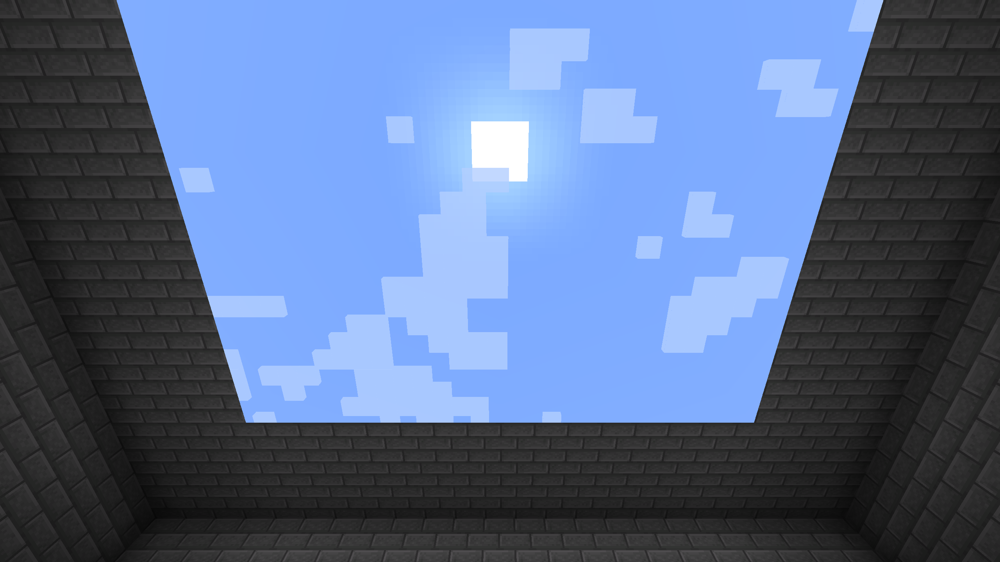

# Sky Window for Minecraft 1.21.1

This guide describes the earlier root-project development baseline. Use [`ports/mc1.21.1`](ports/mc1.21.1) for the current exact-version port and the [compatibility matrix](docs/compatibility.md) for its verification status.

A ceiling block for Minecraft Java Edition 1.21.1 on Fabric that reveals the sky from below, supports per-ceiling time and weather, and supplies real skylight to the room underneath.



**This is a historical experimental development build, not the current compatibility release.** The original live-sky build passed in-game checks with vanilla rendering, a replacement sun resource pack, and Iris 1.8.8 + Sodium 0.6.13 + Complementary Reimagined r5.5.1. The added ceiling settings passed 23 server tests and 22 vanilla client scenarios; the settings paths have not been retested with those packs. Packs can calculate cave fog, exposure, shadows, or path-traced lighting from the actual underground location; those effects are not converted into an above-ground view.

## Install

1. Install Minecraft Java Edition **1.21.1**, Java **21**, and Fabric Loader **0.16.14 or later**.
2. Put **Fabric API 0.116.17+1.21.1** and `sky-window-0.2.0-alpha.1.jar` in the instance's `mods` directory.
3. Install this mod and Fabric API on the server and every joining client when playing multiplayer.
4. Launch the game and replace the room's ceiling with Sky Window blocks.

The block appears in the Functional Blocks creative tab. With commands enabled:

```mcfunction
/give @s sky_window:sky_window 64
```

Craft eight windows using this pattern:

```text
Quartz  Quartz       Quartz
Glass   Ender pearl  Glass
Quartz  Quartz       Quartz
```

Mine windows with a pickaxe to recover them. Their top and sides use quartz textures, and their ordinary underside uses tinted glass. Resource packs can replace these textures or the mod's block model.

## Ceiling settings

Hold **Left Shift** and **right-click** any Sky Window within reach. The panel opens even while holding an item, without placing or using that item.

1. Turn **Follow world** off.
2. Drag the **Time** slider to choose a fixed time of day.
3. Choose **Sunny**, **Rainy**, **Thunderstorm**, or **Snowy**.
4. Click **Apply** to update every window connected through shared faces, including across chunk boundaries and vertically.

Turn **Follow world** back on and click Apply to restore the real sky. Cancel or Escape discards the draft. The panel does not pause the world. Settings persist with the blocks and synchronize to clients; disconnected ceilings can show different skies simultaneously. Newly placed blocks start in Follow world mode until you apply settings to the connected ceiling again.

Change the modifier under **Options → Controls → Key Binds → Sky Window → Settings modifier**. The second input follows Minecraft's **Use Item/Place Block** binding, which defaults to right-click. Sharing Shift with Sneak is supported.

Custom time is fixed; clouds and visual precipitation keep moving. Custom weather appears only in the ceiling: it does not change world weather, create snow layers, make thunder sounds, spawn lightning, or change room lighting. The room's natural skylight continues to follow the real world.

Connections use the six shared faces; blocks touching only at an edge or corner remain independent. All connected blocks and their neighboring chunks must be loaded. Apply rejects the entire change if any member is protected or unloaded, or the ceiling exceeds **16,384 blocks**. The server also checks interaction reach and building permission.

## Behavior

| Situation | Behavior |
| --- | --- |
| Looking up at a window | Reveals the world sky through the underside |
| Looking down or at a side | Displays an ordinary solid decorative block |
| Placing adjacent windows | Forms a continuous sky view without a repeating sky texture |
| Following the world | Follows the world's sun, moon, stars, sky color, storm dimming, and clouds |
| Applying custom settings | Shows fixed time and animated local weather across a connected ceiling |
| Placing a window under rock | Supplies skylight directly below the window |
| Building a tall room | Preserves full skylight down unobstructed vertical columns |
| Placing a solid block below a window | Blocks direct skylight and the view through that block |
| Breaking a window | Removes its light contribution |
| Entering the Nether or End | Retains the decorative appearance; supplies no artificial Overworld sky |

Skylight uses Minecraft's sky-light channel. Its stored value remains 15 in a directly exposed column, just as outdoors; the game's lightmap applies nighttime and weather dimming. Sideways propagation uses vanilla attenuation. The block is solid, emits no block light, and does not physically open the roof or admit rain into the room.

## Resource packs and shaders

**Follow world mode** preserves the sky already drawn by Minecraft and other sky renderers. Vanilla clouds render through the revealed area using the client's graphics settings and installed resources.

**Custom mode** draws an isolated sky using the active resource pack's sun, moon, cloud, rain, and snow textures, with its own sky colors, stars, cloud motion, precipitation, and thunder flashes. It works while Iris is enabled, but does **not** reproduce a shader pack's atmospheric scattering, volumetric clouds, or other custom sky programs. Shader packs generally calculate these effects once per frame using global world uniforms; a different sky per ceiling requires a separately isolated shader pipeline. The mod does not change those global uniforms.

The optional Iris integration restores distant sky depth before Iris copies its depth buffers and runs deferred shaders, then protects the opening during translucent terrain rendering. This allows packs to recognize the visible area as sky and render their own atmospheric effects.

| Configuration | Scope |
| --- | --- |
| Vanilla sky textures and ordinary resource packs | Reuses the installed resources through the existing renderer |
| Custom sky renderer mods | Preserves their sky pass; each mod combination needs verification |
| Iris shader packs | Includes pipeline integration; each pack needs visual verification |
| Shader sun shadows and path tracing | Uses the real world geometry, including the rock overhead |
| Shader cave fog and exposure | Uses the real camera location and pack rules |
| Shader temporal anti-aliasing or custom projections | Can produce aperture-edge artifacts; requires pack-specific testing |
| Rain or snow in Follow world mode | Keeps vanilla weather-heightmap behavior; does not create an indoor weather portal |
| Rain or snow in custom mode | Draws animated precipitation inside the window using the resource-pack textures |
| Custom sky with Iris enabled | Uses the mod's isolated sky appearance; shader-specific sky effects apply only in Follow world mode |
| OptiFine, alternate render engines, and nonstandard depth pipelines | Unsupported |

The integration targets Iris's 1.21.1 rendering pipeline. Compatibility must be retested after Iris updates. See [verification](docs/verification.md) for the checks performed and remaining visual cases.

[View the tested Iris sky](docs/images/iris-day.png) or [the resource-pack texture check](docs/images/resource-pack-sun.png).

## Build

Use a Java 21 JDK:

```sh
./gradlew build
```

Windows:

```bat
gradlew.bat build
```

The installable file is `build/libs/sky-window-0.2.0-alpha.1.jar`. The `-sources.jar` file is for development.

Run the server-side Minecraft tests:

```sh
./gradlew runGameTest
```

Run a development client:

```sh
./gradlew runClient
```

Run the automated visual scenarios in an isolated development world:

```sh
./gradlew runClientSmoke --no-daemon
```

Screenshots and measured light/weather values go to `build/render-test`. This run creates a fresh test world, captures live sky, settings controls, local weather, and independent ceiling scenarios, and closes the client. `COMPLETE.txt` means capture finished; the PNG files still need visual inspection. Normal client launches do not run this harness.

Test mods and test structures are in a separate Gradle source set and are excluded from the installable mod. The repository pins its build dependencies and verifies the Gradle distribution checksum.

## Implementation

The renderer maintains a client index of loaded windows. After the sky renders, it writes the visible underside geometry into a depth-only framebuffer sharing the world's depth texture. This prevents geometry behind the window from replacing the sky while allowing nearer objects to render. A separate depth mask identifies window pixels so their depth can be restored before sky effects run. Two reusable depth textures avoid copying the sky's color attachments or replacing pack-generated colors.

Custom skies are grouped by settings and drawn after the world's shader pass. The renderer restores the nearest window depth before composition so a farther custom ceiling cannot overwrite a nearer live ceiling. Foreground opaque geometry remains in front. A block-entity setting and server-validated apply packet persist and synchronize each connected component; no world time or weather setter is used by production settings code.

The lighting integration discovers windows in loaded chunks, tracks direct skylight columns, and uses Minecraft's lighting queues for propagation and removal. Full blocks and voxel-shape occlusion stop the direct column. This runs on the server and client lighting engines, with normal chunk lighting synchronization.

Reference APIs: [Yarn WorldRenderer](https://maven.fabricmc.net/docs/yarn-1.21.1%2Bbuild.3/net/minecraft/client/render/WorldRenderer.html), [Iris rendering pipeline](https://github.com/IrisShaders/Iris/blob/1.21.1/common/src/main/java/net/irisshaders/iris/pipeline/IrisRenderingPipeline.java), and [Iris render stages](https://shaders.properties/current/reference/macros/render_stages/).

Licensed under the [MIT License](LICENSE).
