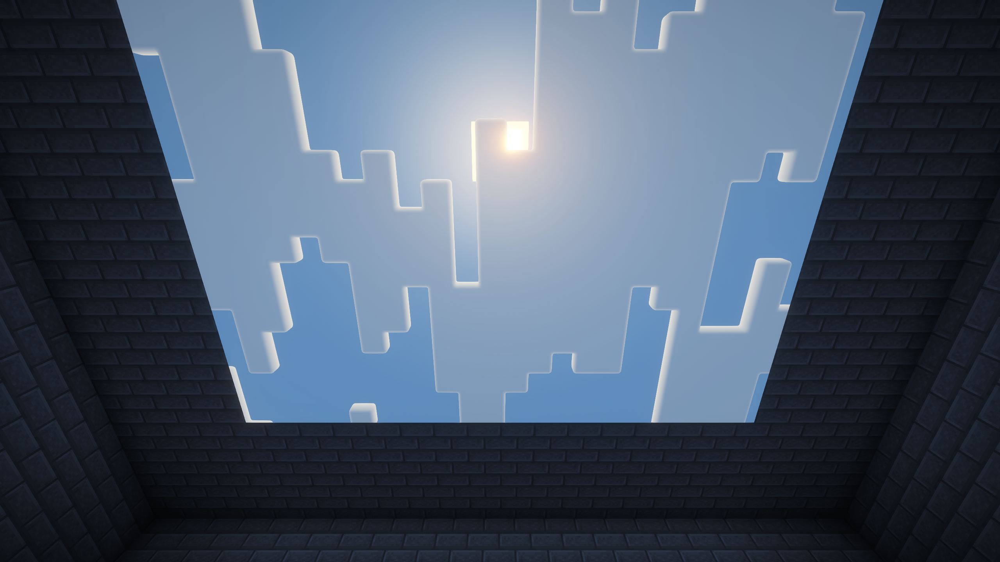

# Sky Window for Minecraft 26.3

A solid decoration block that reveals the sky through its underside, supplies natural skylight underground, and lets connected ceilings show their own time and weather.

**Experimental 26.3 source candidate: `0.3.0-alpha.5+mc26.3`.** Alpha.5 passed the 23 mod server GameTests plus one Fabric baseline test. Its manual-sky walking check with enabled Iris shaders passed visual review, and its current static and movement profiles exited cleanly. See the [verification report](docs/verification.md) for reviewed configurations and historical results. This project targets Minecraft Java **26.3 only**. Earlier releases have separate [source projects and verification status](../../docs/compatibility.md); a finished compatibility bundle is not published in this snapshot.



Examples: [settings panel](docs/images/settings.png), [custom snow](docs/images/custom-snow.png), [walking before the fix](docs/images/walking-before.png), [walking after the fix](docs/images/walking-after.png).

## Install

1. Build the production JAR from this directory. Install Minecraft Java **26.3**, Java **25**, and Fabric Loader **0.19.5 or later**.
2. Put **Fabric API 0.161.0+26.3** and `sky-window-0.3.0-alpha.5+mc26.3.jar` in the instance's `mods` directory.
3. Install Sky Window and Fabric API on the server and every joining client for multiplayer.
4. Replace the room's ceiling with Sky Window blocks.

Find the block in the **Functional Blocks** creative tab, or use:

```mcfunction
/give @s sky_window:sky_window 64
```

Craft eight windows using six quartz, two glass, and one ender pearl:

```text
Quartz  Quartz       Quartz
Glass   Ender pearl  Glass
Quartz  Quartz       Quartz
```

Mine windows with a pickaxe. The top and sides use quartz textures; the decorative underside uses tinted glass when the sky view is unavailable.

## Change a ceiling's sky

Hold **Left Shift** and **right-click** a Sky Window within reach, including while holding an item.

1. Turn **Follow world** off.
2. Drag the **Time** slider to choose a fixed time of day.
3. Select **Sunny**, **Rainy**, **Thunderstorm**, or **Snowy**.
4. Click **Apply**.

Apply updates every window connected through one of its six faces, including vertical connections and connections across chunk boundaries. Edge or corner contact does not connect blocks. Disconnected ceilings can use different settings. Newly placed windows start in Follow world mode; apply again to include them in an existing ceiling's settings.

Turn Follow world on and click Apply to restore the real sky. Cancel or Escape discards the draft. The panel does not pause the world. Settings are stored with each block and synchronized to clients.

Rebind **Settings modifier** under **Options → Controls → Key Binds → Sky Window**. The second input follows Minecraft's **Use Item/Place Block** binding, which defaults to right-click. Sharing Left Shift with Sneak is supported.

Custom time stays fixed while clouds and visual precipitation animate. The setting changes the ceiling view only: real time, weather, and room lighting stay unchanged. Snow is visual; it creates no snow layers. Thunderstorms create no world lightning or thunder sounds.

All connected blocks and their neighboring chunks must be loaded. Apply rejects the entire change if a member is protected, a required chunk is unloaded, or the ceiling exceeds **16,384 blocks**. The server checks interaction reach and building permission.

## Rendering and lighting

| Situation | Result |
| --- | --- |
| Viewing the underside | Displays the live sky or the ceiling's custom sky |
| Viewing the top or a side | Displays a solid decorative block |
| Joining adjacent windows | Creates a continuous view without individual sky tiles |
| Placing foreground opaque blocks | Keeps nearer blocks in front of the sky view |
| Using Follow world | Follows real sky time, cloud movement, and storm darkening |
| Using custom settings | Uses a fixed time and animated local weather |
| Illuminating the room | Supplies the SKY light channel, with normal sideways falloff and obstruction |
| Entering the Nether or End | Uses the decorative fallback |

The block remains solid. Its skylight follows the real world's day/night and weather brightness. Opaque blocks below a window stop the direct skylight column; normal light propagation continues around the opening.

## Resource packs and shaders

Live mode captures Minecraft's native sky and clouds with vanilla rendering. Inspected vanilla and resource-pack views confirm live sky, custom settings, and replacement sun textures. The Iris path preserves the shader pack's sky buffers and exposes the window pixels to its deferred and composite sky effects. The inspected alpha.5 Iris static run showed the pack's clouds, bloom, night sky, and storms, with foreground blocks remaining in front. Cloud clipping and temporal effects can still appear at aperture edges.

Custom mode uses the mod's own vanilla-style sky renderer. It reads the active resource pack's sun, moon, cloud, rain, and snow textures and the current biome/dimension's base sky color. Its weather effects are approximations; the moon phase follows the real world. With Iris, custom mode is composed after the shader pack's final world pass. **Custom ceilings do not reproduce shader-pack-specific skies, clouds, or postprocessing.**

Shader packs can calculate underground fog, exposure, shadows, and lighting from the actual camera and roof geometry. Those calculations still see the real location. Live rain/snow precipitation remains subject to Minecraft's world heightmap. Temporal antialiasing can affect aperture edges. Sky Windows now use the actual terrain projection, including view bobbing, hurt tilt, and nausea transforms.

The tested shader combination is **Iris 1.11.6+mc26.3**, **Sodium 0.9.2+mc26.3**, and **Complementary Reimagined r5.9.3**, using the **HIGH** profile. These are optional and are not bundled. Other packs require their own checks. See [verification status](docs/verification.md).

## Build and verify

Run these commands from this directory with Java 25 available through `JAVA_HOME` or `PATH`. The wrapper pins **Gradle 9.7.0**; the project uses **Fabric Loom 1.18.2**.

```sh
./gradlew build --console plain
```

The production JAR is written to `build/libs/sky-window-0.3.0-alpha.5+mc26.3.jar`. Test mods are separate development source sets.

```sh
./gradlew runGameTest --console plain
./gradlew runClientSmoke --console plain --no-daemon
```

The opt-in client smoke run creates an isolated test world, operates the settings panel and Apply networking path, records screenshots, and exits. Its captures and measurements are in `build/render-test`. A normal client run does not start the smoke harness.

For the optional Iris run, place Complementary Reimagined r5.9.3 in `run/client-smoke/shaderpacks`, enable it in that instance's Iris settings, then run:

```sh
./gradlew -PirisSmoke runClientSmoke --console plain --no-daemon
```

The development flag loads the pinned Iris/Sodium JARs from this workspace's `.tooling` directory. Captures are written to `build/render-test-iris`.

For the replacement-sun resource test:

```sh
python3 scripts/create-sky-test-pack.py
./gradlew -PresourceSmoke runClientSmoke --console plain --no-daemon
```

The script enables its generated pack only in `run/client-smoke`. Captures are written to `build/render-test-resources`.

For the walking regression with Iris installed and its shader pack disabled:

```sh
./gradlew runClientSmoke -PmovementSmoke -PirisDisabledSmoke --console plain --no-daemon
```

This run uses `run/client-smoke-movement`, walks through ceiling chunk boundaries, switches view bobbing off and on, and rebuilds nearby terrain while walking. Clear noon pixels must fill at least 99.5% of the central ceiling sample. Add `-PsmokeOutput=build/my-movement-run` to preserve a separate result. Run `-PmovementSmoke` alone for vanilla movement, add `-PirisSmoke` for enabled shaders, or add `-PresourceSmoke` after creating the replacement-sun pack. The vanilla color assertion is disabled for active shaders and resource packs; their captures need visual review. Use `-PmanualMovementSmoke` instead of `-PmovementSmoke` to walk beneath a custom Sunny/noon ceiling; the harness verifies the ceiling settings and unchanged real weather.

Licensed under the [MIT License](LICENSE).
